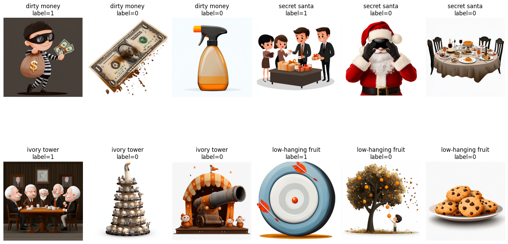
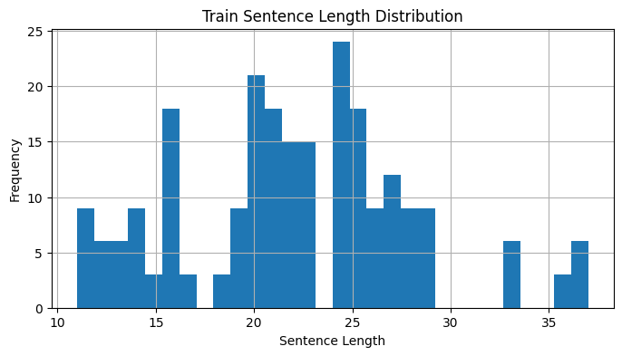
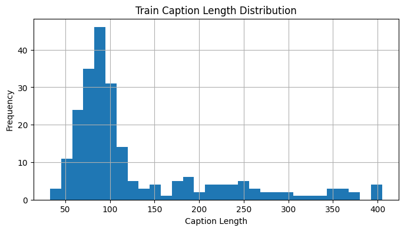
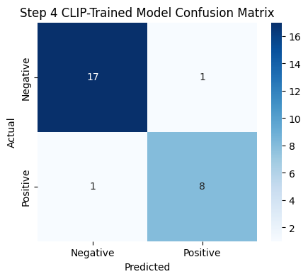
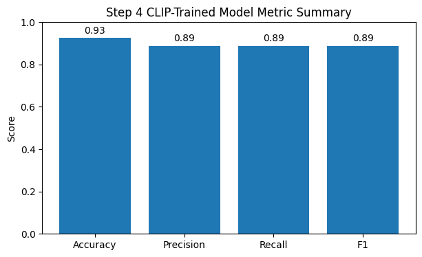

# Contextual Idiom Image Matching Using CLIP

## Project Overview

This project explores the use of Natural Language Processing (NLP) and multimodal machine learning to identify images that match the intended meaning of idiomatic expressions in context.

Idioms often have meanings that differ from their literal interpretations. For example, the phrase "hot potato" can refer to a difficult or controversial issue rather than an actual potato.

The goal of this project is to identify the image that best represents the contextual meaning of an idiomatic expression from a set of three candidate images.

## Project Objectives

- Explore the relationship between idiomatic expressions, sentences, image captions and images.
- Evaluate zero-shot image-text matching using CLIP.
- Experiment with LLM-based data augmentation using FLAN-T5.
- Develop a trained CLIP-based classification model.
- Compare zero-shot and trained-model performance.

## Dataset

The dataset contains idiomatic expressions paired with contextual sentences and three candidate images per group.

Each record includes:
- `compound`: The idiomatic expression.
- `sentence_type`: The type of sentence.
- `sentence`: The sentence containing the expression.
- `image_name`: The candidate image filename.
- `image_caption`: A textual description of the image.
- `label`: Indicates whether the candidate image is the correct match.

The dataset was divided into:

| Split | Rows | Groups |
|---|---:|---:|
| Training | 231 | 77 |
| Validation | 27 | 9 |
| Testing | 27 | 9 |
| **Total** | **285** | **95** |

Each group contains three candidate images, with exactly one positive example.

## Methodology

### 1. Exploratory Data Analysis

The dataset was examined to understand:
- Text length distributions.
- Label distribution.
- Sentence-caption overlap.
- Group structure and candidate-image distribution.
- Relationships between idiomatic expressions and image captions.

### 2. LLM-Based Data Augmentation

FLAN-T5 was used to generate:
- Paraphrased sentences.
- Short explanations of idiomatic meanings (glosses).

Generated text was filtered using quality checks before being considered for augmentation.

The augmentation process generated 77 unique training groups, of which one passed the filtering criteria (approximately 1.3% coverage).

### 3. Zero-Shot CLIP Evaluation

OpenAI's pretrained CLIP model (ViT-B/32) was used to calculate image-text similarity.

A weighted similarity-fusion approach combined:
- Image-context similarity.
- Caption-context similarity.
- Image-gloss similarity.
- Caption-gloss similarity.

The candidate with the highest combined score was selected.

### 4. Trained CLIP-Based Model

A Logistic Regression classifier was trained using features extracted from CLIP.

The feature representation included:
- Text embeddings.
- Image embeddings.
- Absolute differences between text and image embeddings.
- Cosine similarity between text and image embeddings.

The classifier used balanced class weights and was evaluated on the validation and test sets.

## Results

The following table presents the reported test-set results.

| Metric | Zero-Shot CLIP | Trained CLIP-Based Model |
|---|---:|---:|
| Row Accuracy | 0.4074 | 0.9259 |
| Precision | 0.1111 | 0.8889 |
| Recall | 0.1111 | 0.8889 |
| F1-score | 0.1111 | 0.8889 |
| Group Accuracy | 0.1111 | 0.8889 |

The trained CLIP-based model performed substantially better than the zero-shot approach on this test set.

**Important limitation:** The test set contains only 27 rows across 9 groups. The reported performance should therefore be interpreted cautiously and validated on a larger test set.

## Visual Results

### Dataset Samples


### Exploratory Data Analysis





### Model Evaluation





## Interactive Demonstration

The notebook also includes a demonstration where the user can:
1. Enter an idiomatic expression.
2. Enter a sentence containing the expression.
3. Upload exactly three candidate images.
4. Obtain similarity-based prediction scores.
5. View the ranked images and the predicted best match.

## Technologies Used

- Python
- PyTorch
- OpenAI CLIP (ViT-B/32)
- Hugging Face Transformers
- FLAN-T5
- Scikit-learn
- NumPy
- Pandas
- Matplotlib
- Seaborn
- Pillow
- Google Colab

## Repository Structure

```text
NLP-Project/
│
├── notebooks/
│   └── NLP.ipynb
│
├── results/
│   ├── figures/
│   └── metrics/
│       └── model-evaluation.txt
│
├── README.md
├── requirements.txt
└── .gitignore
```

## Installation and Usage

1. Clone or download this repository.
2. Install the required dependencies:

   ```bash
   pip install -r requirements.txt
   ```

3. Open `notebooks/NLP.ipynb` in Google Colab.
4. Provide the dataset CSV files and corresponding images in the directory structure expected by the notebook.
5. Update the Google Drive path (`fpath`) in the notebook if necessary.
6. Run the notebook cells in order.

The interactive demonstration requires the trained model checkpoint generated during the notebook execution.

## Conclusion

This project investigates contextual idiom interpretation through multimodal image-text matching.

It compares pretrained zero-shot CLIP similarity scoring with a trained CLIP-feature-based Logistic Regression classifier. The results demonstrate the potential of combining visual and textual representations for contextual meaning identification, while also highlighting the need for larger evaluation datasets and improved data augmentation quality.
