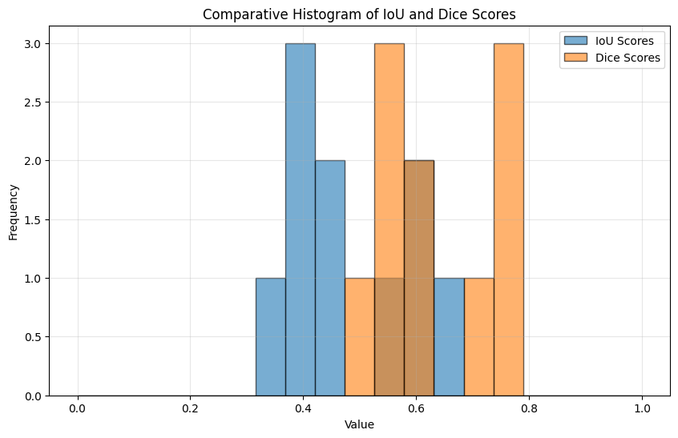

# Retinal OCT Cyst Segmentation Using K-Means Clustering

## Project Overview

This project explores the segmentation of cysts in retinal Optical Coherence Tomography (OCT) images using classical image processing techniques and K-means clustering.
The objective is to identify potential cyst regions in OCT scans, generate binary segmentation masks, and evaluate the segmentation results against ground truth annotations.

## Methodology

The project follows these main steps:

1. **Image preprocessing**
   - Median filtering
   - Bilateral filtering
   - Non-local means denoising

2. **Image segmentation**
   - K-means clustering with K = 4
   - Pixel intensity clustering
   - Selection of the darkest cluster as the candidate cyst region

3. **Evaluation**
   - Intersection over Union (IoU)
   - Dice Similarity Coefficient (Dice)

## Results

The initial experiment was conducted on 10 OCT images.

| Metric | Average Score |
|---|---:|
| IoU | 0.4757 |
| Dice | 0.6380 |

### Segmentation Examples

The following examples show the original OCT images, segmentation outputs, and corresponding ground-truth annotations.


### Evaluation Graph



## Limitations

- The experiment was evaluated on a small sample of 10 images.
- Selecting the darkest intensity cluster does not guarantee that all identified regions correspond to cysts.
- Other dark anatomical structures and image noise may affect segmentation.
- The current implementation uses classical image processing rather than deep learning.
- Ground truth mask preprocessing and foreground/background conventions should be verified.

The reported metrics represent an initial experiment and should not be interpreted as clinical performance.

## Repository Structure

```text
retinal-oct-segmentation/
├── src/
│   ├── preprocessing.py
│   ├── segmentation.py
│   ├── evaluation.py
│   └── main.py
├── notebooks/
├── results/
│   ├── segmentation_samples/
│   └── metrics/
├── docs/
├── requirements.txt
├── .gitignore
└── README.md
```

## Technologies Used

- Python
- NumPy
- OpenCV
- Matplotlib
- Google Colab

## Future Improvements

- Improve cyst region identification.
- Evaluate the method on a larger dataset.
- Explore alternative segmentation techniques.
- Compare classical segmentation methods with deep learning approaches.

## Author

Chinmayee Shree N R\
Developed as a student research and technical project exploring medical image processing and retinal OCT segmentation.
